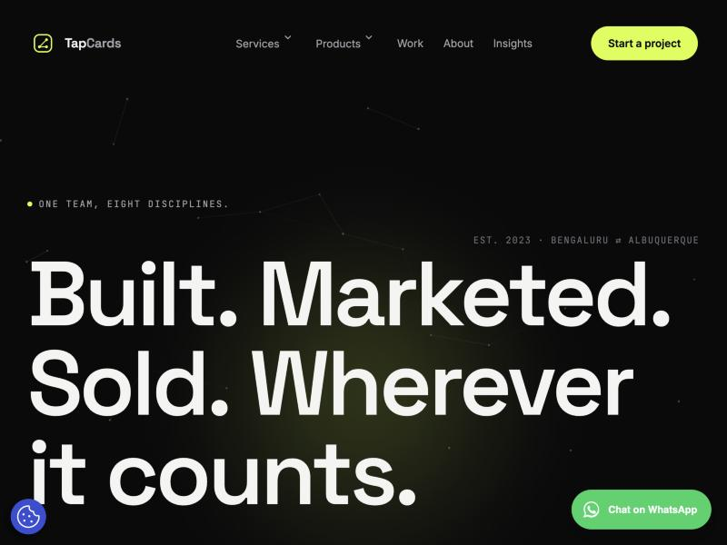

# TapCards — Studio Brand Site

> Built. Marketed. Sold. Wherever it counts. · One team, eight disciplines.

**TapCards** is the brand/studio site for TapCards LLC — software, web, marketing, and a SaaS suite built by one team. I designed and hand-coded it as a **custom WordPress block theme with no page builder**, with a motion-rich, dark-first design and a strong technical-SEO foundation.

🔗 **Live:** [tapcards.in](https://tapcards.in)

> This repository is a **case study** — it documents the design and front-end engineering behind the site.

---

## Highlights

- **Hand-coded block theme, no builder** — deliberately built without Elementor/page-builders. PHP logic (loops/conditionals) runs through `ob_start()` shortcodes wired into block templates, keeping the editor clean and the markup lean.
- **Design tokens** — a dark-first palette with a signal-lime accent defined in `theme.json`; hand-written CSS reads WordPress's generated custom properties instead of duplicating values.
- **Custom motion** — a vanilla-canvas node-link hero (no dependency) plus GSAP-driven kinetic headline reveals, scroll reveals, magnetic buttons, SVG line-draw diagrams, animated counters, a custom cursor, and a once-per-session brand intro loader.
- **Accessibility & resilience** — every animation degrades under `prefers-reduced-motion`, and a forced-visible safety net guarantees content never gets stuck invisible for real users or crawlers.
- **Self-hosted variable fonts** — Space Grotesk / Inter / JetBrains Mono, served locally (zero Google Fonts requests).
- **Technical SEO** — JSON-LD (`Organization` + `WebSite` + a `ProfessionalService` per office), breadcrumbs kept in sync with `BreadcrumbList` schema, and a single source-of-truth content/data model so one theme powers multiple domains.

## Engineering notes

The theme intentionally uses **flexbox over CSS grid** for any looped/templated container (to avoid whitespace text-nodes being counted as phantom grid items), and scopes fixed-overlay stacking to a single wrapper so third-party plugin modals are never broken by blanket selectors — small, hard-won details that keep a hand-built theme robust.

## Tech

**WordPress (block theme) · PHP · JavaScript · GSAP · Canvas · CSS · JSON-LD / Schema.org**

## My role

Designer & front-end engineer — visual design, theme architecture, animation, accessibility, and SEO.

---

© TapCards LLC. Branding belongs to TapCards LLC. This case study is for portfolio purposes.
